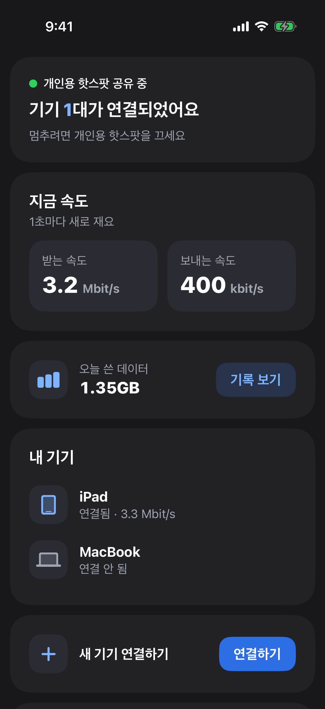
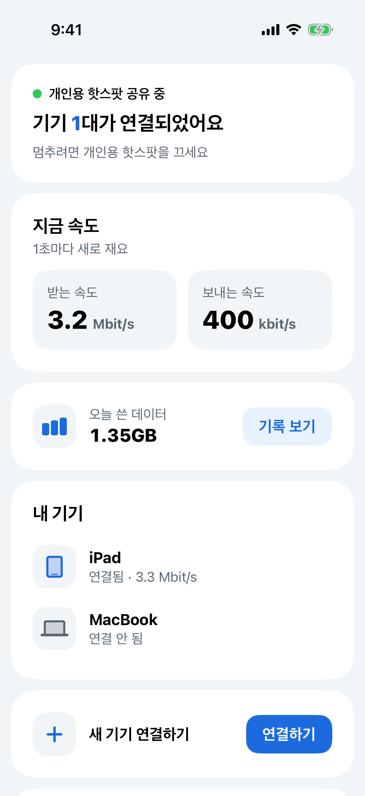
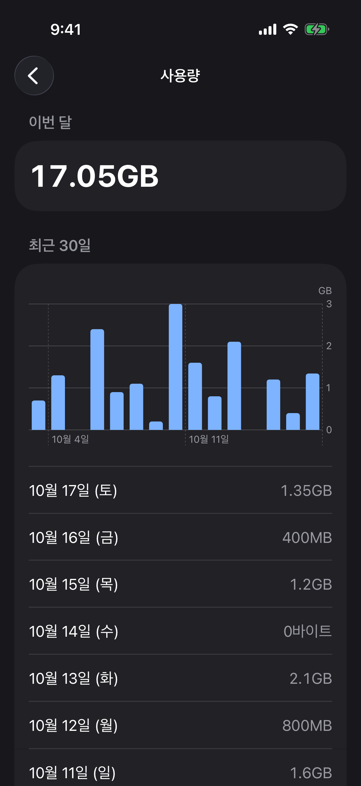
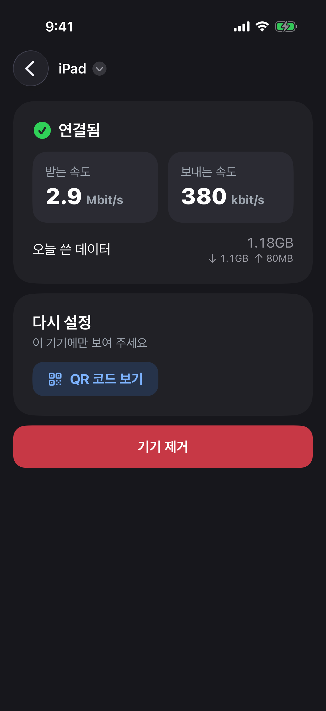
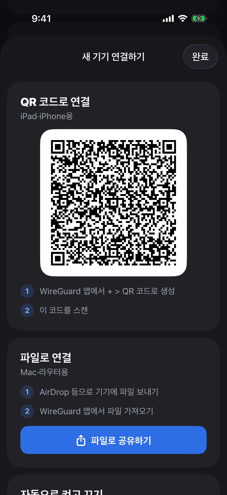

# Flux

**한국어** · [English](README.en.md)

요금제가 개인용 핫스팟을 막거나 느리게 만들어도, iPhone의 인터넷을 iPad, Mac, 여행용 라우터와 나눠 쓸 수 있게 해 주는 앱입니다.

**연결할 기기에는 WireGuard 클라이언트가 있어야 합니다.** iPad, iPhone, Mac에서는 무료 WireGuard 앱을 쓰면 되고, 여행용 라우터(GL.iNet, UniFi Travel Router 등)는 대부분 기본으로 들어 있습니다. WireGuard가 없는 기기도 핫스팟에는 붙을 수 있지만, 그 트래픽은 그대로 핫스팟 트래픽으로 나가서 Flux가 도와줄 수 없습니다.


    

스크린샷은 Actions > Screenshots가 데모 화면에서 찍습니다.

## 어떻게 되는 건가요

통신사는 핫스팟에 연결된 기기에서 나온 트래픽을 구분할 수 있고, 어떤 요금제는 그걸 막거나 아주 느리게 만듭니다. iPhone 자체에서 나온 트래픽은 괜찮습니다.

Flux는 iPhone에서 도는 작은 앱입니다. iPad, Mac, 여행용 라우터는 그대로 핫스팟에 붙지만, 트래픽을 바로 내보내는 대신 WireGuard 클라이언트가 Flux에게 넘깁니다. Flux가 연결을 직접 다시 만들기 때문에, 트래픽은 iPhone 자신의 것처럼 나갑니다.

```
iPad, Mac, 라우터  ──핫스팟──▶  iPhone의 Flux  ──셀룰러──▶  인터넷
(WireGuard 클라이언트)
```

내부적으로 Flux는 핫스팟 주소 `172.20.10.1`의 UDP 51820 포트에서 WireGuard 서버를 돌립니다. 각 기기는 WireGuard 클라이언트로 연결하고, 통화와 게임을 포함해 모든 트래픽이 지나갑니다. WireGuard 코드가 트래픽을 풀고, Flux 안의 작은 TCP/IP 스택([gVisor](https://gvisor.dev))이 iPhone에서 연결을 하나하나 다시 만듭니다. UDP는 full-cone NAT처럼 동작해서 통화나 게임도 직접 연결되고, `ping`도 됩니다. iPhone이 대신 보내고, 실제로 응답하는 호스트만 답이 옵니다. iPhone에 VPN 권한이나 네트워크 확장은 필요 없습니다.

## iPhone에 설치하기

개인용 핫스팟이 되는 iPhone이 있어야 하고, Xcode가 설치된 Mac이나 본인의 서명 인증서가 필요합니다. Mac이 있으면 무료 Apple ID로도 됩니다.

### Mac 없이: Releases의 IPA

모든 버전이 이 저장소의 **Releases** 페이지에 서명되지 않은 `Flux-<버전>.ipa`로 올라가 있습니다. 설치하려면:

1. 원하는 버전의 IPA를 Releases에서 받습니다.
2. 서명 앱이나 Sideloadly, AltStore 같은 도구로 본인 인증서로 서명해서 설치합니다. 새 버전을 설치할 때마다 번들 ID를 `com.personal.flux`로 유지하세요. 서명 도구가 번들 ID를 바꾸면 새 키를 가진 Flux가 하나 더 설치되고, 기기를 모두 다시 추가해야 합니다.

어떤 인증서로 서명했든, 인증서가 3일 이하로 남으면 Flux 메인 화면에 표시됩니다.

새 버전 만들기: [CHANGELOG.md](CHANGELOG.md) 맨 위에 `## 1.3`처럼 새 버전 제목을 달고 바뀐 점을 적은 다음, Actions > **Release** > Run workflow에서 `main`을 고르고 `1.3`처럼 버전을 입력합니다. 테스트를 돌리고, 그 버전으로 IPA를 만들고, CHANGELOG.md의 그 부분을 설명으로 붙여 Releases에 올립니다. 10분쯤 걸립니다. `v1.3` 같은 태그를 푸시해도 똑같이 됩니다. Actions > **Build IPA**는 버전 없이 아무 브랜치나 빌드해서 시험해 볼 때 씁니다. 그 IPA는 실행 결과물로 90일 동안 보관됩니다.

### Mac과 Xcode로

1. [XcodeGen](https://github.com/yonaskolb/XcodeGen)과 Go를 설치합니다(`brew install xcodegen go`). `xcodegen generate`가 먼저 Go로 WireGuard 부분을 빌드합니다. `scripts/build-wireguard.sh`를 보세요.
2. `project.yml`을 열어 `DEVELOPMENT_TEAM`에 본인 팀 ID를 넣고(비어 있습니다), `com.personal.flux`를 쓸 수 없으면 `APP_BUNDLE_ID`를 `com.yourname.flux`처럼 겹치지 않는 값으로 바꿉니다. 팀 ID는 Xcode의 Settings > Accounts에 있습니다.
3. 빌드하고 설치합니다:

   ```sh
   xcodegen generate
   xcodebuild build -project Flux.xcodeproj -scheme Flux \
     -destination "id=<your-iphone-udid>" -derivedDataPath .build-dd -allowProvisioningUpdates
   xcrun devicectl device install app --device <your-iphone-udid> \
     .build-dd/Build/Products/Debug-iphoneos/Flux.app
   ```

   iPhone의 UDID는 `xcrun devicectl list devices`로 볼 수 있습니다.

   iPhone에 Flux가 이미 있으면 같은 번들 ID로 빌드하세요. 아니면 새 키를 가진 Flux가 옆에 하나 더 설치되고, 기기를 모두 다시 추가해야 합니다. 설치된 번들 ID는 `xcrun devicectl device info apps --device <your-iphone-udid>`로 확인하고, `xcodebuild` 줄 끝에 `APP_BUNDLE_ID=<그 ID>`를 붙이면 됩니다.
4. 처음에는 개발자 인증서를 신뢰해야 앱이 열립니다: 설정 > 일반 > VPN 및 기기 관리 > 본인 Apple ID > 신뢰.
5. Flux를 엽니다. 개인용 핫스팟을 기다렸다가 핫스팟이 켜지면 알아서 시작합니다. 백그라운드에 둬도 됩니다.

## WireGuard로 기기 연결하기

iPad, iPhone, Mac, 여행용 라우터 모두 됩니다. 통화와 게임을 포함해 모든 트래픽이 지나가고, 다른 Wi-Fi에서는 아무것도 바뀌지 않습니다.

Flux 메인 화면의 새 기기 연결하기 옆 **연결하기**를 누르면, 설정하는 두 가지 방법과 자동으로 켜는 방법이 담긴 시트가 열립니다. 그 QR 코드와 파일의 키는 Flux가 미리 만들어 둡니다. 기기가 처음 연결되면 내 기기 목록에 기기, 기기 2 같은 이름으로 저절로 나타나고, 다음 기기를 위한 새 키가 만들어집니다. 기기를 누르면 연결 상태를 보거나 지울 수 있고, 맨 위의 이름을 누르면 이름을 바꿀 수 있습니다.

- **iPad, iPhone은 QR 코드로:** 무료 [WireGuard](https://apps.apple.com/app/id1441195209) 앱을 설치하고, + > QR 코드에서 생성을 눌러 시트의 코드를 찍습니다.
- **Mac은 파일로:** 시트에서 **파일로 공유하기**를 눌러 Mac으로 보내고(AirDrop 가능), WireGuard에서 파일에서 터널 가져오기를 합니다. Mac은 iPhone 화면을 찍을 수 없으니까요.
- **여행용 라우터**(UniFi Travel Router, GL.iNet 등): 공유한 파일로 라우터 VPN 설정에 WireGuard 클라이언트를 추가하고, 라우터를 USB나 핫스팟으로 iPhone에 연결한 뒤 VPN을 켭니다. 어떤 라우터는 터널 주소 대신 연결된 기기들의 주소로 트래픽을 보내는데, Flux가 알아서 알아채고 통과시킵니다. 라우터의 사용량에는 그 뒤의 모든 기기가 포함됩니다. 다른 네트워크에서는 라우터의 VPN을 끄세요.
- **자동으로 켜고 끄기:** iPad, iPhone, Mac의 WireGuard에서 터널을 편집해 Wi-Fi에 대한 On-Demand를 켜고, iPhone 핫스팟 이름만 고릅니다. 그러면 핫스팟에서는 터널이 저절로 켜지고 다른 곳에서는 꺼집니다.

기기마다 키가 따로 있습니다. Flux에서 기기를 지우면 다른 기기는 그대로 두고 그 기기만 막힙니다.

기기는 Cloudflare DNS(1.1.1.1)를 씁니다. Flux 메인 화면의 설정 > DNS에서 Google, Quad9, AdGuard(광고 차단), 또는 직접 입력한 IPv4 주소 최대 4개로 바꿀 수 있습니다. 이 설정은 QR 코드와 파일에 들어가므로, 그 뒤로 추가하는 기기에 적용됩니다. 이미 추가한 기기는 원래 DNS를 그대로 씁니다. 그 기기의 WireGuard 터널에서 바꾸거나, 기기를 지우고 다시 추가하세요.

## 단축어로 시작하기

10분 동안 핫스팟에 기기가 없으면 iOS가 Flux를 정지시키고, 핫스팟을 다시 쓰기 전에 Flux를 다시 열어야 합니다. 단축어가 그걸 대신해 줍니다. Flux는 단축어 앱에 동작 두 개를 추가하고, 따로 설정할 건 없습니다:

- **Flux 시작**은 Flux를 연 것처럼 백그라운드에서 깨우지만, 화면에는 띄우지 않습니다. 그 뒤 10분 안에 기기가 개인용 핫스팟에 붙으면 바로 공유를 시작합니다. (iOS는 기기가 붙어 있을 때만 핫스팟 네트워크를 만들기 때문에, 그때 Flux가 볼 수 있습니다.)
- **Flux 공유 중인가요?**는 공유 중인지, 기기가 몇 대 연결됐는지 알려 줍니다. 만약(If)에 쓸 수 있게 참/거짓을 돌려줍니다.

Siri에게 "Flux 시작"이라고 말하거나, Spotlight에서 찾거나, 동작 버튼에 넣을 수도 있습니다.

iOS에는 '개인용 핫스팟이 켜질 때' 자동화가 없으니, 단축어 하나로 둘 다 켜세요:

1. 단축어에서 **핫스팟**이라는 새 단축어를 만들고, **개인용 핫스팟 설정**을 켬으로, 그다음 **Flux 시작**, 이렇게 두 동작을 넣습니다.
2. 설정에서 핫스팟을 켜는 대신 이걸 실행합니다. 동작 버튼, 위젯, Siri("핫스팟") 어디서든 됩니다.
3. 저절로 실행되게 하려면 단축어 > 자동화에서 핫스팟을 실행하고 즉시 실행으로 둔 자동화를 추가합니다. 예를 들어 차 블루투스가 연결될 때, 공유하는 장소에 도착할 때, 정해진 시간에.

## 알아둘 것

- **인증서가 만료되면 열리지 않습니다.** 무료 Apple ID는 7일 뒤, 본인 인증서는 그 인증서가 끝날 때입니다. 3일 이하로 남으면 메인 화면에 표시됩니다. 그 전에 같은 번들 ID로 다시 설치하세요. 기기와 설정은 그대로 남습니다.
- **계속 켜 두세요.** Flux는 iOS가 백그라운드에서 정지시키지 않도록 소리 없는 오디오를 재생합니다. 다른 오디오와 섞이니 음악은 계속 나오고, 통화나 Siri 뒤에도 다시 이어집니다. 10분 동안 핫스팟에 기기가 없으면 배터리를 아끼려고 멈추고, iOS가 Flux를 정지시킵니다. 핫스팟을 다시 켜기 전과 iPhone을 재시동한 뒤에는 Flux를 다시 열거나 Flux 시작을 실행하세요.
- **핫스팟에서만 듣습니다.** 다른 Wi-Fi 네트워크에서는 듣지 않고, WireGuard는 추가한 기기만 들여보냅니다.
- **기기는 iPhone이 닿는 곳에 닿습니다.** 사설 네트워크도 포함됩니다. iPhone에 VPN이 켜져 있으면 기기들도 그 VPN을 쓰므로, 그 네트워크가 기기들과 추가한 여행용 라우터 뒤의 모든 기기에 열립니다.
- **메인 화면**에는 연결된 기기 수, 지금 받는 속도와 보내는 속도, 오늘 쓴 데이터(기록 보기에서 이번 달), 연결됨·연결 안 됨이 표시된 내 기기, 새 기기 연결하기 버튼이 있습니다. 기기 화면에는 그 기기가 오늘 쓴 데이터가 나오고, 여행용 라우터는 그 뒤의 모든 기기를 포함합니다. 오늘 사용량은 자정에 다시 시작합니다. 공유를 멈추려면 개인용 핫스팟을 끄세요.
- **한국어와 영어**를 지원하고, iPhone 언어를 따릅니다.
- **화면 모드**: 메인 화면의 설정 > 화면 모드에서 자동(iPhone 설정을 따름, 기본값), 라이트, 다크를 고를 수 있습니다.
- **트래픽은 iPhone의 것으로 나갑니다.** iPhone에 VPN이 켜져 있으면 공유한 트래픽도 그 VPN을 거칩니다.
- **통신사가 알아챌 수는 있습니다.** Flux는 트래픽이 어디서 왔는지를 숨기지, 무엇인지를 숨기지는 않습니다. Mac의 소프트웨어 업데이트나 iPad 앱은 자세히 보는 통신사에게 여전히 Mac이나 iPad처럼 보입니다. 많은 통신사 약관이 테더링 우회를 허용하지 않고, 어기면 속도를 줄이거나 회선을 끊을 수 있습니다. 본인 약관을 확인하세요. Flux를 쓰는 건 본인의 판단이고 책임입니다.
- **App Store용이 아닙니다.** Apple은 소리 없는 오디오 방식을 허용하지 않으니, Flux는 직접 빌드해서 설치합니다.

## 개발자용

```
Sources/WireGuardServer.swift  WireGuard 서버 실행; WireGuardSetup.swift에 키와 설정
WireGuard/                   Go로 만든 WireGuard 서버: wireguard-go와 gVisor TCP/IP 스택
scripts/build-wireguard.sh   WireGuard/를 FluxWG.xcframework로 빌드 (xcodegen이 실행)
Sources/Model.swift          핫스팟을 찾고, 서버를 시작하고, 트래픽을 재서 화면에 전달
Sources/MainView.swift       메인 화면; DevicesView.swift에 새 기기 연결 시트와 기기 화면
Sources/Theme.swift          카드, 버튼, 확인 시트, 브랜드 색
Sources/Appearance.swift     자동, 라이트, 다크 설정
Sources/KeepAlive.swift      백그라운드에서 살아 있기 위한 소리 없는 오디오
Sources/Shortcuts.swift      단축어와 Siri용 Flux 시작, Flux 공유 중인가요? 동작
Sources/Usage.swift          오늘 사용량, 전체와 기기별
Sources/ko.lproj/            한국어 문구; 영어는 코드에 있음
Sources/DemoMode.swift       UI 테스트용 가짜 앱 상태 (Debug 빌드에서만)
Tests/                       Mac에서 도는 유닛 테스트
UITests/                     iOS 시뮬레이터에서 도는 화면별 UI 테스트
scripts/make-icon.py         앱 아이콘(파란 클레이 물결)을 그림 (Python, Pillow)
```

모든 소스 파일 목록은 Model.swift 맨 위에 있습니다.

CI는 푸시할 때마다 GitHub의 Mac에서 모든 테스트, 퍼징, 앱 빌드를 돌립니다(`.github/workflows/ci.yml`). UI 테스트와 IPA 빌드는 Actions 탭에서 필요할 때 돌립니다.

유닛 테스트는 `swift test`로 돌립니다(WireGuard 서버를 링크하므로 `scripts/build-wireguard.sh`나 `xcodegen generate` 뒤에). WireGuard 서버 자체의 테스트는 `go -C WireGuard test ./...`입니다. Mac에서 실제 서버를 띄우고 루프백으로 통신하므로 기기가 없어도 됩니다. 시뮬레이터 UI 테스트와 손으로 하는 확인은 [TESTING.md](TESTING.md)에 있습니다.

## 라이선스

MIT, [LICENSE](LICENSE)를 보세요. Flux는 Viktor Svirsky의 Tether(역시 MIT)에서 시작했고, 그 저작권 표시는 LICENSE에 남아 있습니다.

WireGuard 서버는 [wireguard-go](https://git.zx2c4.com/wireguard-go)(MIT), [gVisor](https://gvisor.dev)(Apache 2.0), Go의 `golang.org/x` 패키지(BSD)로 만듭니다. `WireGuard/go.mod`가 버전을 고정하고, Go가 각각의 라이선스와 함께 받아 옵니다. 빌드한 Flux 앱에는 이 코드가 들어 있으니, 빌드를 다른 사람에게 줄 때는 이 라이선스들도 함께 주세요.
